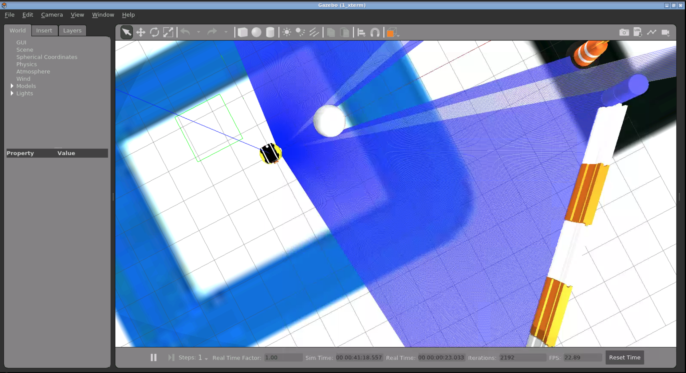
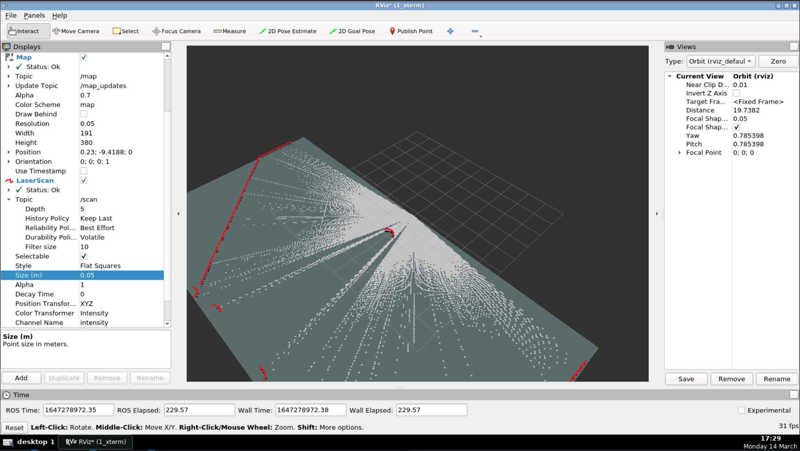

# Autonomous Indoor Exploration with SLAM & Nav2

A SLAM-based autonomous navigation system for indoor exploration, built on ROS 2 and a simulated **Neobotix MP-400** mobile robot in Gazebo. The robot builds a map of an unknown environment with **SLAM Toolbox** while a custom Python **frontier exploration** node picks where to go next and sends goals to the **Nav2** stack.

<p align="center">
  
  
</p>

## Features

- **Simulated robot:** Neobotix MP-400 with a 2D LiDAR in Gazebo (`neo_track1` world by default).
- **LiDAR SLAM:** SLAM Toolbox in online asynchronous mode builds the occupancy grid and localizes the robot at the same time, with loop closure handled by the Ceres solver.
- **Autonomous navigation:** Nav2 plans paths and avoids obstacles on the way to each goal.
- **Frontier exploration:** A custom Python node finds the boundary between known free space and unknown space and sends the robot there until no frontiers are left.
- **Map serving:** Saved maps can be loaded again with `nav2_map_server` for localization and navigation.

## System Architecture

```
 ┌──────────────┐  /scan, /odom, /tf   ┌──────────────────┐   /map    ┌────────────────────┐
 │ Gazebo +     │ ───────────────────▶ │  SLAM Toolbox    │ ────────▶ │  frontier_explore  │
 │ MP-400 robot │                      │ (online async)   │           │  (explore_bot)     │
 └──────▲───────┘                      └────────┬─────────┘           └─────────┬──────────┘
        │ /cmd_vel                              │ map → odom TF                 │ NavigateToPose
        │                              ┌────────▼─────────┐                     │ (action)
        └───────────────────────────── │       Nav2       │ ◀───────────────────┘
                                       │ planner/controller│
                                       └──────────────────┘
```

## Repository Structure

```
.
├── ros2_ws/                      # Main workspace
│   └── src/
│       ├── explore_bot/          # Custom frontier exploration node (Python)
│       │   └── explore_bot/frontier_explore.py
│       └── ros2_mapping/         # SLAM Toolbox + map server launch/config
│           ├── config/
│           │   ├── mapper_params_online_async.yaml
│           │   ├── mapper_params_lifelong.yaml
│           │   └── my_map.yaml / my_map.pgm      # Saved map
│           └── launch/
│               ├── online_async_launch.py        # SLAM (mapping)
│               ├── lifelong_launch.py            # Lifelong SLAM
│               └── provide_map.launch.py         # Map server + RViz
├── simulation2_ws/               # Neobotix simulation workspace
│   └── src/neobotix_ros2/neo_simulation2/
│       ├── launch/               # simulation, mapping, navigation, teleop
│       ├── robots/               # MP-400, MP-500, MPO-500/700 URDFs
│       ├── configs/mp_400/       # Nav2 + mapping params for MP-400
│       ├── worlds/               # neo_track1, neo_workshop, ...
│       └── maps/
└── webpage_ws/                   # Screenshots
```

## How Frontier Exploration Works

`explore_bot/frontier_explore.py` runs a timer every 5 seconds that does the following:

1. **Read the map.** It subscribes to `/map` (`nav_msgs/OccupancyGrid`) and turns it into a NumPy array.
2. **Find frontiers.** A frontier is a **free cell** (`0`) that has at least one **unknown** neighbour (`-1`) in its 3×3 neighbourhood.
3. **Choose a target.** It picks the closest frontier it has not visited yet and marks it as visited.
4. **Convert to world coordinates.** Grid indices become metres using the map `resolution` and `origin`.
5. **Navigate.** It sends a `NavigateToPose` goal to Nav2 through an action client and logs whether the goal was accepted and what the result was.
6. **Finish.** When no frontiers remain, the map is complete and exploration stops.

## Requirements

- Ubuntu 20.04
- ROS 2 **Galactic**
- Gazebo 11 (`gazebo_ros_pkgs`)
- `slam_toolbox`, `navigation2`, `nav2_bringup`
- Python 3 with `numpy`

```bash
sudo apt install ros-galactic-slam-toolbox ros-galactic-navigation2 \
                 ros-galactic-nav2-bringup ros-galactic-gazebo-ros-pkgs \
                 python3-numpy
```

## Build

```bash
# Simulation workspace
cd simulation2_ws
colcon build
source install/setup.bash

# Main workspace
cd ../ros2_ws
colcon build
source install/setup.bash
```

## Usage

Run each step in its own terminal, with both workspaces sourced.

**1. Start the simulation (Gazebo + MP-400)**

```bash
export GAZEBO_MODEL_PATH=$PWD/simulation2_ws/src/neobotix_ros2/neo_simulation2/models:$GAZEBO_MODEL_PATH
ros2 launch neo_simulation2 simulation.launch.py
```

**2. Start SLAM Toolbox**

```bash
ros2 launch ros2_mapping online_async_launch.py
```

**3. Start Nav2**

```bash
ros2 launch nav2_bringup navigation_launch.py use_sim_time:=True \
  params_file:=$PWD/simulation2_ws/src/neobotix_ros2/neo_simulation2/configs/mp_400/navigation.yaml
```

**4. Start autonomous exploration** (after Nav2 is up)

```bash
ros2 run explore_bot frontier_explore
```

**5. Visualize in RViz**

```bash
rviz2
```

Add the `Map` (`/map`) and `LaserScan` displays and set the fixed frame to `map`.

**6. Save the map**

```bash
ros2 run nav2_map_server map_saver_cli -f ros2_ws/src/ros2_mapping/config/my_map
```

**7. Load a saved map (optional)**

```bash
ros2 launch ros2_mapping provide_map.launch.py
```

## Configuration

| File | Purpose |
|------|---------|
| `ros2_mapping/config/mapper_params_online_async.yaml` | SLAM Toolbox settings: frames, scan topic, 0.05 m resolution, loop closure |
| `neo_simulation2/configs/mp_400/navigation.yaml` | Nav2 planner, controller and costmap settings for the MP-400 |
| `neo_simulation2/launch/simulation.launch.py` | Robot model (`MY_NEO_ROBOT`) and world (`MY_NEO_ENVIRONMENT`) |

> **Note:** The MP-400 LiDAR publishes on `/base_scan`, which is what the SLAM params use. The Nav2 costmaps in `configs/mp_400/navigation.yaml` listen on `/scan`. If obstacles don't appear in the costmap, change those topics to `/base_scan`.


## Acknowledgements

- [Neobotix ROS 2 simulation](https://github.com/neobotix/neo_simulation2)
- [SLAM Toolbox](https://github.com/SteveMacenski/slam_toolbox)

